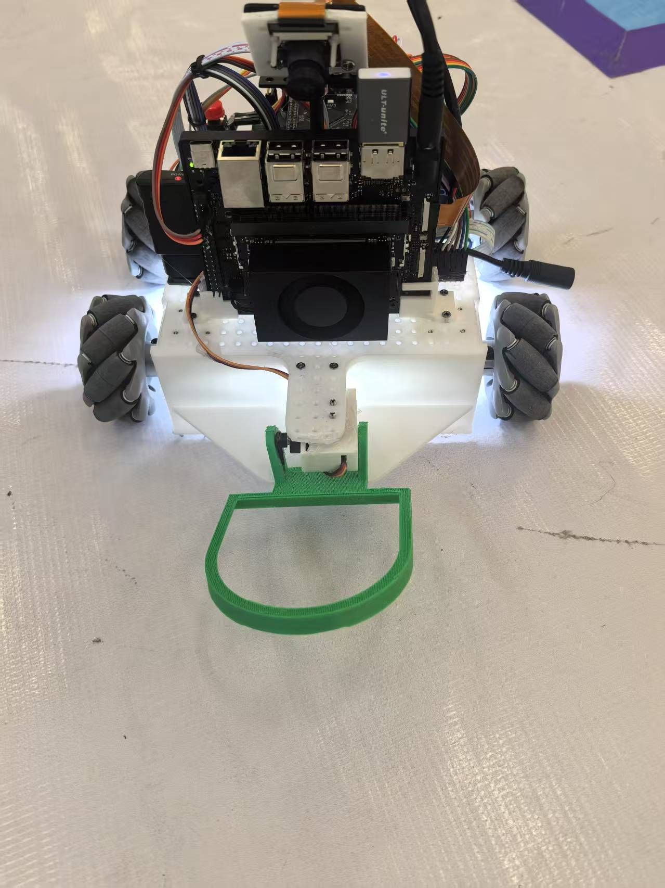
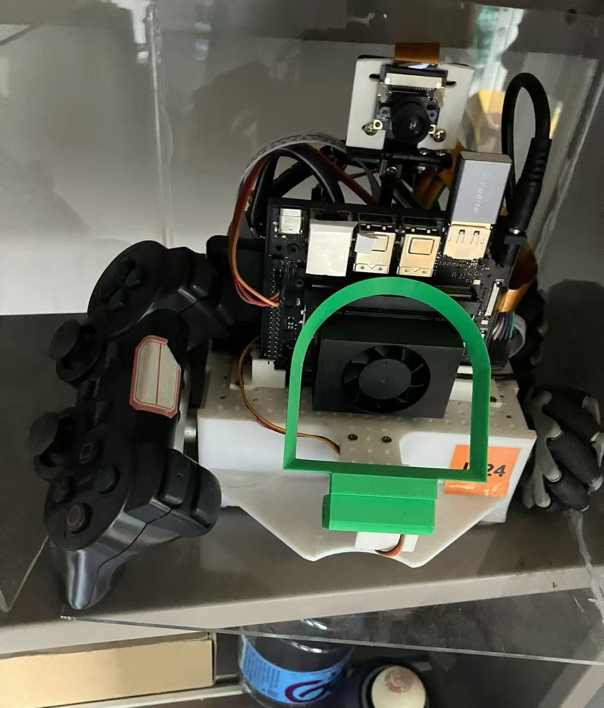

# 智能救援机器人

本项目面向目标识别、物体收集与安全区域转运任务，采用 **NVIDIA Jetson + STM32** 协同架构，集成移动底盘、视觉感知、供电系统和夹爪机构。团队完成了从目标识别、收集到指定安全区域转运的完整救援流程。

作品获得 **2025 年中国大学生工程实践与创新能力大赛山西赛区一等奖、智能救援赛项第一名**。

## 我的主要工作

- **系统架构**：规划整机组成，统筹计算平台、控制单元、供电与执行机构之间的配合。
- **供电设计**：负责机器人供电方案，与主控平台及执行机构进行系统集成。
- **底盘与夹爪设计**：根据移动、目标收集和转运需求设计结构，采用模块化快拆底盘，方便装配、调试与部件更换。

## 作品实物

 

左图展示整车与夹爪机构，右图展示计算平台、摄像头及硬件布局。

